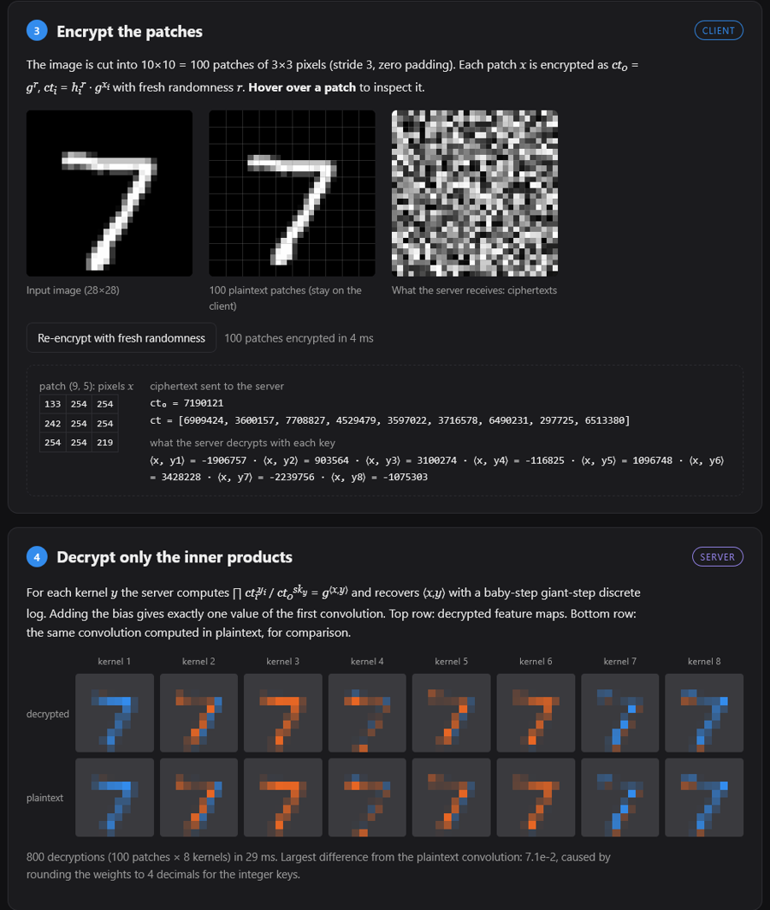
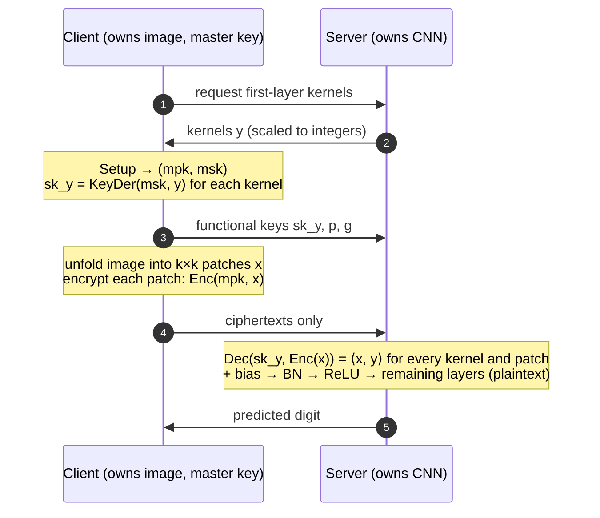
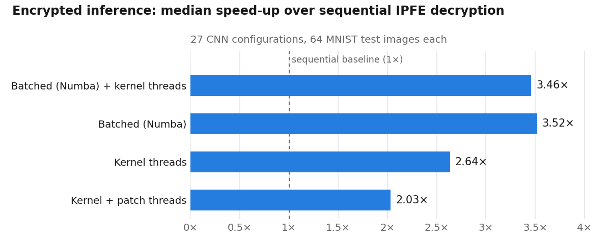

# PPML: Privacy-Preserving CNN Inference with Functional Encryption

[](https://github.com/CedricBohni/PPML/actions/workflows/ci.yml)


[](LICENSE)

Classify an image **without the server ever seeing the image**. A client encrypts MNIST digits with
**Inner-Product Functional Encryption (IPFE)**. The server receives one functional key per first-layer
convolution kernel. With these keys it can compute exactly the kernel–patch inner products from the
ciphertexts, and nothing else, then it finishes the CNN in plaintext.

### ▶ [Try the interactive demo](https://cedricbohni.github.io/PPML/)

Pick or draw a digit and watch it go through the protocol in your browser: key generation, the patches turned
into ciphertext noise, decryption of only the inner products, and the final prediction.

<a href="https://cedricbohni.github.io/PPML/"></a>

Built as the **2025 Integrated Masters Project** by *Cedric Bohni* and *Konstantin Wehmeyer*.

**Highlights**

- **DDH-based IPFE from scratch** ([Abdalla et al., PKC 2015](https://eprint.iacr.org/2015/017)), including
  key derivation, baby-step giant-step discrete logs and automatic prime selection for a given network.
- **Encrypted inference keeps the plaintext accuracy.** Test accuracy is the same in 21 of 24 benchmarked
  CNN configurations. The only difference in the logits comes from quantizing the weights to 10⁻⁴.
- **About 8.5× faster** encrypted evaluation than the pure-Python baseline. Numba-compiled batch decryption
  gives about 3.5× (median over 27 configurations). Releasing the GIL so that kernel threads run in
  parallel gives another 2.6–2.9× ([details](#releasing-the-gil)).
- **Reproducible research pipeline:** 8 step-by-step notebooks, a config-driven benchmark suite with
  29 pretrained checkpoints, a TCP client–server demo, tests and CI.

## How it works



The scheme works over the group ℤₚ* with generator *g*. The master secret key is *s* = (*s*₁, …, *sₗ*) and the
public key is *hᵢ* = *g^sᵢ*.

| Step | Operation |
|---|---|
| Encrypt patch **x** | ct₀ = *g^r*, ctᵢ = *hᵢ^r* · *g^xᵢ* |
| Key for kernel **y** | sk_y = ⟨**s**, **y**⟩ |
| Decrypt | ∏ ctᵢ^yᵢ / ct₀^sk_y = *g*^⟨**x**,**y**⟩, then recover ⟨**x**,**y**⟩ with baby-step giant-step |

Kernel weights are scaled by 10⁴ and rounded to integers. The prime *p* must exceed twice the largest
possible |⟨**x**,**y**⟩| so that negative results can be recovered. [`prime_finder`](src/cryptography/prime_finder.py)
derives this bound from the trained weights and returns the next prime above it.

## Results

<picture>
  <source media="(prefers-color-scheme: dark)" srcset="docs/speedup-dark.png">
  
</picture>

The chart and the tables below come from the original benchmark in `results/`, recorded before the
[GIL fix](#releasing-the-gil). Selected configurations, timed on 64 MNIST test images (seconds for the
whole encrypted evaluation):

| Model | Params | Plain acc. | IPFE acc. | Sequential (s) | Batched Numba (s) |
|---|--:|--:|--:|--:|--:|
| 2×2, stride 2, 8→64 channels | 34,194 | – | 100.0% | 48.8 | 13.9 |
| 3×3, stride 2, 8→64 channels | 34,234 | 100.0% | 100.0% | 46.1 | 14.2 |
| 3×3, stride 1, 16→64 channels | 98,666 | 98.4% | 98.4% | 444.3 | 112.7 |
| 5×5, stride 2, 8→32 channels | 11,642 | 100.0% | 100.0% | 48.1 | 13.5 |
| 5×5, stride 1, 16→64 channels | 98,922 | 100.0% | 100.0% | 479.8 | 136.8 |

The full table for all 28 models and every strategy is in [docs/results.md](docs/results.md) (raw data in
[docs/results.csv](docs/results.csv)). To regenerate the table and the chart from `results/`:

```bash
uv run python scripts/summarize_results.py --out docs/results.md --csv docs/results.csv
uv run python scripts/plot_results.py
```

**What the numbers show**

- Cost scales with the number of patches × kernels. A 3×3 first layer with stride 1 produces 784 patches
  per image, against 100 with stride 3, and takes about 8–9× as long.
- Most of the speed-up comes from Numba. The baseline decrypts with the pure-Python implementation,
  while all four strategies use the JIT-compiled one. Batching every patch into a single compiled loop
  per kernel is fastest.
- Threads added little or even cost time: kernel + patch threads were slower than kernel threads alone.
  The Numba functions were compiled without `nogil=True`, so they held Python's GIL and the threads
  couldn't decrypt in parallel. The next section fixes this.
- Accuracy differs in three configurations. Two of them are off by one image out of 64. The model whose
  first layer has a single output channel drops to 68.8%.

### Releasing the GIL

The benchmark above showed that the thread-based strategies weren't really parallel. All of the
Numba-compiled functions now use `@njit(nogil=True)`. They work on plain integers and arrays, so they
can run without Python's Global Interpreter Lock, and the thread pools now decrypt different kernels
on different cores at the same time.

Each pair below was measured back to back on the same 16 MNIST test images, with the JIT warmed up and
the same keys, on a laptop with 8 logical CPUs. Every strategy predicts exactly the same digits.

| Strategy | 3×3, stride 3: before → after | 3×3, stride 1: before → after |
|---|--:|--:|
| Batched (Numba) + kernel threads | 3.12 s → **1.08 s** (2.9×) | 18.89 s → **7.28 s** (2.6×) |
| Kernel threads | 3.55 s → 1.88 s (1.9×) | 23.05 s → 14.43 s (1.6×) |
| Kernel + patch threads | 5.25 s → 3.57 s (1.5×) | 32.43 s → 22.76 s (1.4×) |
| Batched (Numba), no threads | 3.02 s → 3.08 s (unchanged) | 19.52 s → 19.26 s (unchanged) |

With the GIL released, batched decryption plus kernel threads went from being no better than batching
alone to the fastest strategy, at about **8.5× the sequential baseline** (9.11 s → 1.08 s and
62.5 s → 7.3 s). The gain is bounded by the number of first-layer kernels (8 here) and CPU cores. The
strategy that doesn't use threads stays the same, which confirms the gain comes from parallelism.

To reproduce the comparison on your machine:

```bash
uv run python scripts/benchmark_strategies.py --images 16
```

## Quick start

This project uses [uv](https://docs.astral.sh/uv/). It supports Python 3.12 and 3.13; uv downloads a
suitable interpreter automatically.

```bash
git clone https://github.com/CedricBohni/PPML.git
cd PPML
uv sync
uv run pytest
```

`uv run pytest` runs the tests, which takes about 20 s.

Run every command from the repository root. The MNIST dataset is downloaded to `./data` on first use.

<details>
<summary>Without uv (pip)</summary>

`requirements.txt` is exported from `uv.lock` (`uv export --no-dev --no-hashes --no-emit-project -o requirements.txt`):

```bash
python -m venv .venv
.venv\Scripts\activate        # Windows; on Linux/macOS: source .venv/bin/activate
pip install -r requirements.txt
```

Then drop the `uv run` prefix from the commands below.
</details>

**Troubleshooting:** if uv fails with `invalid peer certificate: UnknownIssuer`, which is common behind
antivirus software or corporate proxies, add `--system-certs`, e.g. `uv sync --system-certs`.

## Repository layout

```text
├── 00_basic_cnn.ipynb … 04_3_batch_kernel_ipfe_cnn.ipynb   # step-by-step research notebooks
├── src/
│   ├── cryptography/
│   │   ├── cnn_ipfe.py              # reference IPFE implementation (pure Python)
│   │   ├── optimized_cnn_ipfe.py    # Numba-accelerated IPFE + batch decryption
│   │   ├── prime_finder.py          # smallest safe prime for a given first layer
│   │   └── prototype/               # first IPFE prototype on raw vectors
│   ├── cnn/
│   │   ├── models.py                # PlainCNN and IPFECNN (encrypted first layer, 4 strategies)
│   │   ├── data.py, train.py, eval.py, utils.py
│   ├── utils/math_helper.py         # modular arithmetic, generators, primes, discrete log
│   └── main.py                      # config-driven benchmark suite
├── Demo/                            # TCP client–server encrypted inference demo
├── configs/base.yaml                # benchmark configuration
├── models/                          # 29 pretrained benchmark checkpoints (+ notebook/demo models)
├── results/                         # raw benchmark outputs (one .txt per run)
├── site/                            # interactive in-browser demo (GitHub Pages)
├── scripts/                         # results, benchmark and web-model export scripts
├── docs/                            # generated results table and figures
└── tests/                           # pytest suite (IPFE correctness, math, encrypted vs. plain CNN)
```

## Notebooks

The notebooks walk through every experimental step, each building on the previous one. Start Jupyter
with `uv run jupyter lab` and run them **in order**:

1. **`00_basic_cnn.ipynb`**: trains and evaluates a simple CNN on MNIST, visualizing filters and activations.
2. **`01_modified_cnn.ipynb`**: explores CNN variations (architecture, preprocessing) and trains weights
   for IPFE. Saves `models/cnn_model_1.pth`.
3. **`02_basic_ipfe_cnn.ipynb`**: applies IPFE to the first CNN layer.
4. **`03_extracted_encrypt_ipfe_cnn.ipynb`**: extracts and encrypts image patches separately, using an
   optimized prime.
5. **`04_0_kernel_ipfe_cnn.ipynb`**: applies IPFE at the kernel level.
6. **`04_1_kernel_patch_ipfe_cnn.ipynb`**: tests the kernel-patch approach and compares results.
7. **`04_2_batch_ipfe_cnn.ipynb`**: batch-based performance measurements and parallel decryption with
   compiler optimizations.
8. **`04_3_batch_kernel_ipfe_cnn.ipynb`**: extends the batching approach to kernel-level IPFE.

Some notebooks load pretrained weights from `models/`; check the top cells for a `load model` option.
Long-running cells show progress bars. Interrupt the kernel to stop them.

## Benchmark suite

[`src/main.py`](src/main.py) trains or loads a CNN described by [`configs/base.yaml`](configs/base.yaml),
evaluates it in plaintext or under IPFE, and writes the metrics to `results/`.

```bash
uv run python -m src.main -r 1          # -r: repeat the run n times; --cfg: alternative config file
```

The default config uses the committed checkpoint `models/k3_conv8_16_32_64_stride3_pad1_dropout0.5.pt` and a
matching prime, so it runs without training. Set `model.name: "ipfe"` and `data.max_test_samples: 64` to try
encrypted inference on 64 images in under a minute.

**Workflow**

1. **Configure** `configs/base.yaml`:
   - `seed`, `device`, `data.batch_size`, `data.num_workers`
   - `data.max_test_samples`: limit the number of test images (empty = all)
   - `ipfe.prime` and `ipfe.encryption_length` (k², e.g. 4 for a 2×2 kernel)
   - `model.name`: `"plain"` (unencrypted) or `"ipfe"` (encrypted). An encrypted run needs a trained
     plain model with the same architecture.
   - Architecture: `in_channels`, `num_classes` and the per-layer lists `c` (channels), `k` (kernel sizes),
     `p` (pooling 0/1), `stride` and `padding`. All lists must have the same length. Also `dropout`.
   - `optimizations`: keep `precrypted: true` so that encryption is timed separately. Enable **at most one**
     of `kernel_parallelization`, `kernel_patches_parallelization`, `batch_parallelization` and
     `batch_kernels_parallelization`, or none for the sequential baseline.
2. **Train the base model.** Run with `name: "plain"`. If no checkpoint matches the architecture, the
   suite trains one and saves it as e.g. `models/k2_conv8_16_32_64_stride3_pad1_dropout0.5.pt`.
3. **Pick the prime.** When a plain checkpoint is loaded, the suite prints the bound and a suggested prime:

   ```text
   Maximum absolute inner product over all slices: 313.33173
   Scaled maximum absolute inner product (x10000): 3.1333172e+06
   Suggested prime minimum (scaled max * 2): 6.2666345e+06
   Suggested prime (next prime above minimum): 6266657
   ```

   Put that prime into `ipfe.prime`.
4. **Run encrypted.** Set `name: "ipfe"` and run again. Results are saved to `results/`.

## Client–server demo

A client encrypts MNIST patches, sends only ciphertexts over TCP, and receives the prediction.
Run the two parts in separate terminals from the repository root:

```bash
uv run python -m Demo.server     # listens on 127.0.0.1:5000, loads models/demo_model_{1,2,3}.pth
uv run python -m Demo.client
```

The client's interactive commands:

| Command | Action |
|---|---|
| `1` | Choose a CNN variant and initialize IPFE (prime, generator, vector length, keys) |
| `2` | Choose how many MNIST test images to encrypt (the client unfolds and encrypts each patch) |
| `3` | Send the encrypted patches to the server and receive predictions |
| `0` | Close the demo |

## Development

```bash
uv run pytest                  # tests
uv run ruff check .            # lint
uv run ruff format .           # format
```

CI ([.github/workflows/ci.yml](.github/workflows/ci.yml)) runs lint and tests on every push and pull request.
The tests check IPFE correctness for both implementations, the number-theory helpers, prime selection,
and that every encrypted-inference strategy reproduces the plaintext CNN's predictions.

## Limitations

This is a research prototype that explores how practical IPFE is for CNN inference. It is not a
production-ready secure system.

- **The parameters are not cryptographically secure.** Primes around 10⁶–10⁷ keep the discrete log
  in decryption tractable, but they are far too small for real-world DDH security, which needs groups
  of 2048 bits or more, or elliptic curves.
- **Only the first layer is computed under encryption.** The server learns the first-layer feature
  maps, which reveal partial information about the input. Everything after that runs in plaintext.
- **The client sees the first-layer weights.** In the demo, the client is the key authority, so the
  server sends it the kernels in order to get functional keys for them.
- **Decryption cost grows with the message range,** because baby-step giant-step takes √p time. This
  limits weight precision and the size of the network.

## Authors

**Cedric Bohni** and **Konstantin Wehmeyer**, Integrated Masters Project 2025.

## License

[MIT](LICENSE)
